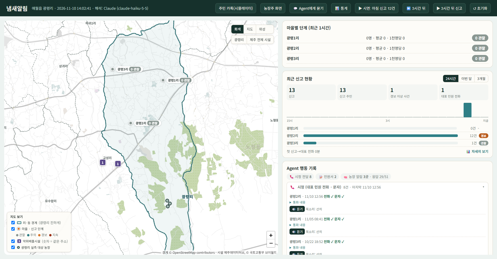
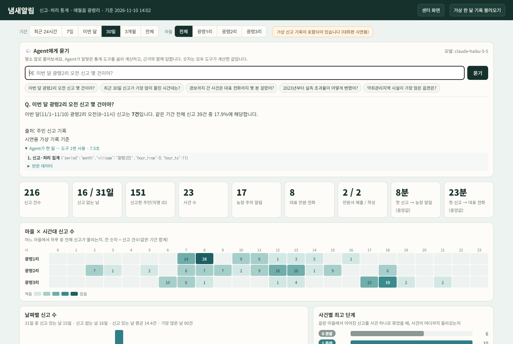
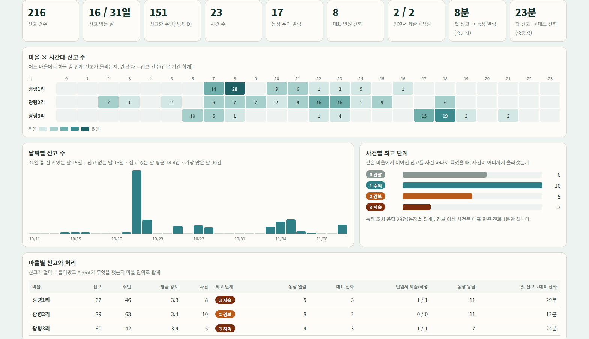
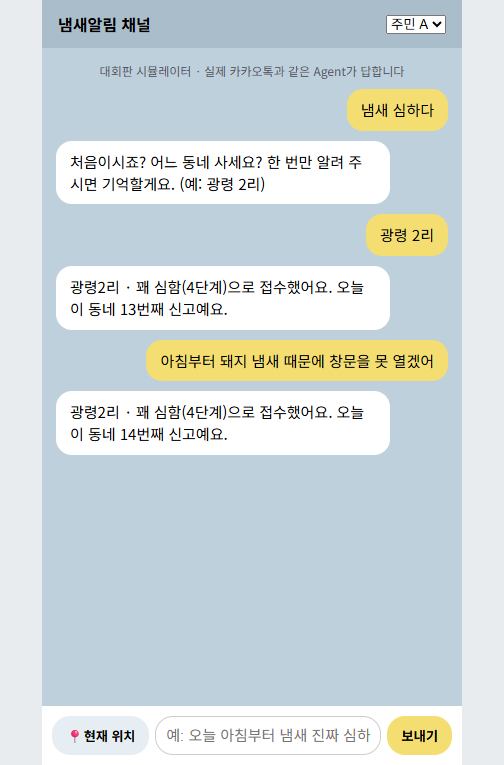
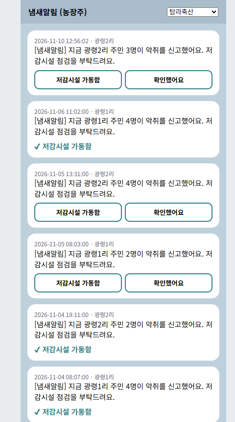

# 냄새알림 사용자 매뉴얼

대상: 제주빅데이터센터 방문자(행정·기업·연구자)와 담당자, 심사위원
실행 방법은 `1_설치_실행_매뉴얼.md` 를 먼저 보세요.

---

## 한눈에 보기

| 화면 | 주소 | 누가 | 무엇을 |
|---|---|---|---|
| 센터 화면 | `http://127.0.0.1:8000` | 센터 담당자·행정 | 지도에서 마을별 신고 단계를 보고, Agent가 한 일을 확인 |
| 통계·Agent에게 묻기 | `/stats.html` | 방문자·행정·사업자 | 말로 물어 분석 답 받기, 마을×시간대 통계 |
| 주민 카톡 | `/chat.html` | 주민(시뮬레이터) | 평소 말로 냄새 신고 |
| 농장주 화면 | `/farm.html` | 농장주(시뮬레이터) | 주의 알림 받고 조치 응답 |

---

## 1. 센터 화면

**지도 (왼쪽)**
- 파란 굵은 선은 **광령리 경계**, 점선은 이웃 리·동입니다(OpenStreetMap).
- **마을 점**: 색이 신고 단계입니다(회색 관찰 → 청록 주의 → 주황 경보 → 적갈 지속). 점이 클수록 최근 1시간 신고 주민이 많고, 경보 이상이면 테두리가 퍼지듯 깜빡입니다.
  - 마을 점을 누르면 최근 1시간 인원, 오늘 신고 수, 마지막 처리, **[이 마을 통계 보기]** 가 나옵니다.
- **보라색 네모**: 악취배출시설(제주데이터허브). 숫자는 같은 주소의 시설 수입니다. 사업장명은 표시하지 않습니다.
- **회색 동그라미**: 광령리 실측 대상 농장(악취조사 DB).
- 오른쪽 위: 배경 [회색 / 지도 / 위성], 보기 이동 [광령리 / 제주 전체 시설]
- 왼쪽 아래: 범례 겸 켜고 끄기

**오른쪽 패널**
- **마을별 단계 (최근 1시간)**: 줄을 누르면 지도가 그 마을로 이동합니다.
- **최근 신고 현황**: [24시간 / 이번 달 / 3개월]을 골라 신고·주민·경보 이상 사건·대표 전화 수와 시간별·날짜별 그래프를 봅니다.
- **Agent 행동 기록**: 동작별로 묶여 있습니다.
  - ⚠ **지금 할 일**: 마을 대표 승인을 기다리는 민원서 → [마을 대표 승인 → 제출]
  - 📞 **시청**: 대표 민원 전화와 문자. [🔊 듣기]로 통화 내용을 들을 수 있습니다(Edge에서 가장 자연스러운 목소리).
  - 📝 **민원서 제출**
  - 🐖 **농장 주의 알림·응답**: 농장별 카드(농장 A·B·C, 이름은 숨김)
- **최근 신고**: 주민이 보낸 문장, 마을, 강도, 시각

**위쪽 버튼 (시연용)**
| 버튼 | 하는 일 |
|---|---|
| ▶ 시연: 아침 신고 12건 | 광령2리에 1시간 안에 신고 12건 → 주의 → 경보, 농장 알림·대표 전화·문자 |
| ⏩ 3시간 뒤 | 시계를 3시간 앞으로 |
| ▶ 3시간 뒤 신고 | 냄새가 이어진다는 신고 → 지속 단계, 민원서 초안 |
| ↺ 초기화 | 모든 기록 지우기 |

## 2. 💬 Agent에게 묻기 (통계 화면 맨 위)

1. 입력창에 평소 말로 묻고 [묻기]를 누르거나, 아래 예시 버튼을 누릅니다.
2. Agent(Claude)가 알맞은 **통계 도구**를 골라 부르고, 도구가 계산한 숫자로 답합니다. 4~9초 걸립니다.
3. 답 아래 **"Agent가 한 일"**을 펼치면 어떤 도구를 어떤 조건(기간·마을·시간대)으로 불렀고 무엇을 받았는지 그대로 보입니다.
4. 앞 질문에 이어서 물을 수 있습니다. 예: "그럼 광령1리는?"

**물어볼 수 있는 것**
| 주제 | 예시 질문 | 쓰는 데이터 |
|---|---|---|
| 신고·처리 | 이번 달 광령2리 오전 신고 몇 건이야? / 이번 주 대표 전화는 몇 번 걸었어? | 주민 신고 기록 |
| 몰리는 때 | 최근 30일 신고가 가장 많이 몰린 시간대는? | 주민 신고 기록 |
| 처리 속도 | 경보까지 간 사건은 대표 전화까지 몇 분 걸렸어? | 주민 신고 기록 |
| 실측 | 2023년부터 실측 초과율이 어떻게 변했어? / 오전과 야간 초과율 비교해 줘 | 악취조사 DB (구역 합산) |
| 시설 | 악취관리지역 시설이 가장 많은 읍면은? / 애월읍 시설 현황 | 제주데이터허브 악취배출시설현황 |

**지키는 원칙**: 숫자는 도구 결과만 씁니다. 특정 농장을 원인으로 지목하거나 이름을 말하지 않습니다. 기간과 출처를 밝히고, 시연용 가상 기록이면 그렇다고 알립니다.

## 3. 통계 화면

- 위에서 기간(24시간·7일·이번 달·30일·3개월·전체)과 마을을 고릅니다.
- 요약 숫자 → 마을×시간대 표 → 날짜별 그래프(신고 없는 날은 회색 줄) → 사건별 최고 단계 → 마을별 합계 → **사건별 처리 기록**(첫 신고부터 농장 알림·대표 전화·민원서까지 걸린 시간)
- 오른쪽 위 **[가상 한 달 기록 불러오기]**: 시연용 30일치 가상 신고를 판단 엔진에 넣습니다(기존 기록은 지워짐). 같은 결과가 나오도록 시드가 고정되어 있습니다.

## 4. 주민 카톡 (시뮬레이터)

- 평소 말로 보냅니다. 처음 한 번만 동네를 묻고, 다음부터는 기억합니다.
- 집이 아닌 곳이면 [📍현재 위치]를 누른 뒤 보냅니다.
- 문장 해석: Claude가 마을·시각·강도·냄새 종류를 뽑습니다(키가 없거나 막히면 규칙 기반).
- 위쪽에서 주민 A~D를 바꿔 여러 사람처럼 보낼 수 있습니다.

## 5. 농장주 화면 (시뮬레이터)

- 위에서 농장을 고르면 그 농장에 온 주의 알림이 보입니다(알림이 온 농장이 먼저 선택됨).
- [저감시설 가동함] / [확인했어요]를 누르면 센터 화면의 농장 카드에 응답이 기록됩니다.
- 농장주에게는 신고자 정보가 가지 않고, 마을과 신고 인원만 갑니다.

## 6. 시연 순서 (5분)

1. 센터 화면 [▶ 시연: 아침 신고 12건] → 광령2리 경보, Agent 행동 기록에 시청 전화·농장 알림 → [🔊 듣기]
2. 농장주 화면에서 [저감시설 가동함] → 센터 화면 농장 카드에 응답
3. [⏩ 3시간 뒤] → [▶ 3시간 뒤 신고] → 지속 단계, ⚠ 지금 할 일에 민원서 → [마을 대표 승인 → 제출]
4. 주민 카톡에서 직접 "냄새 심하다" → 동네 묻기 → 접수 답장
5. 통계 화면 [가상 한 달 기록 불러오기] → 💬 "이번 달 광령2리 오전 신고 몇 건이야?" → "Agent가 한 일" 펼쳐 근거 확인
