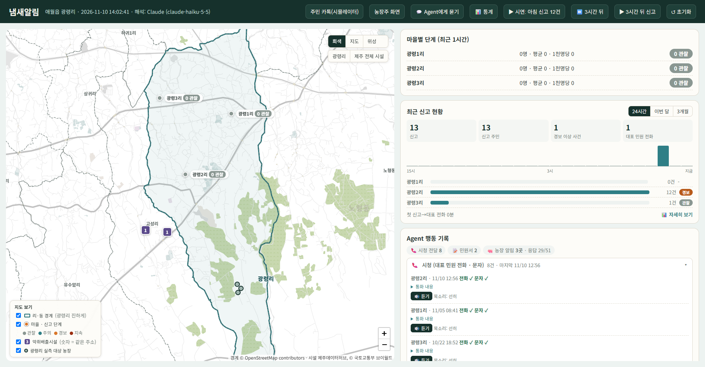
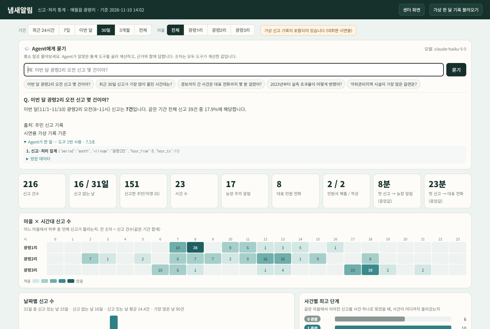
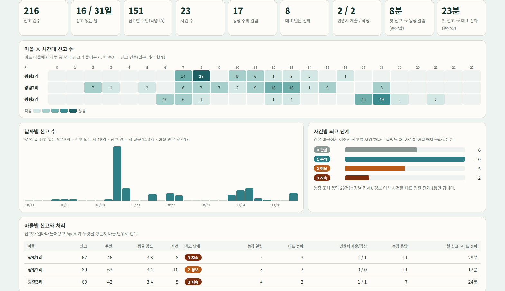
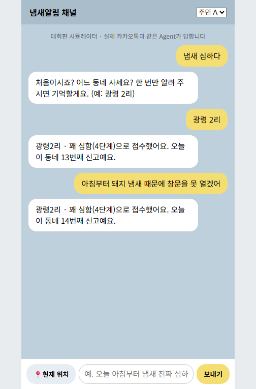
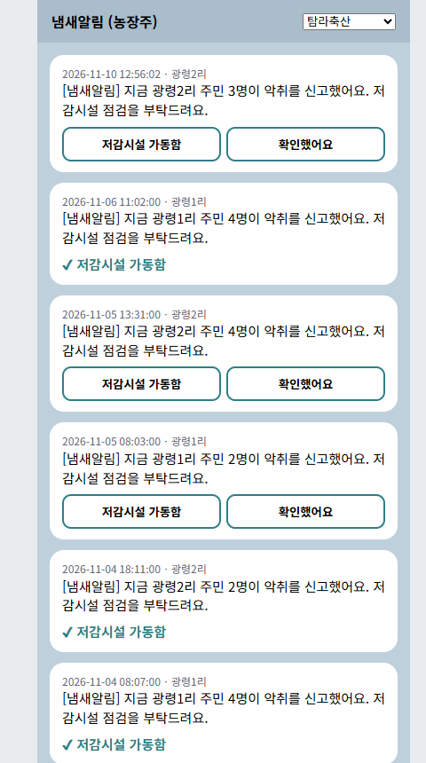

# 냄새알림 결과 설명자료

팀: 애월주민 · 「제주 AI·빅데이터 활용 AI Agent 개발 챌린지」
한 줄 요약: 주민의 카톡 한 줄을 사건·단계·행동으로 바꾸고, 센터 방문자가 말로 물으면 근거와 함께 분석해 주는 악취 대응 AI Agent

---

## 1. 문제 정의

애월읍 광령리는 마을 바로 옆에 양돈단지가 있습니다. 정보공개청구로 받은 제주시 자료(2023.1~2026.9)와 제주악취관리센터 악취조사 DB를 맞춰 보니, 측정과 민원이 서로 만나지 않았습니다.

| 사실 | 값 | 출처 |
|---|---|---|
| 광령리 악취 민원 | 1,778건 (하루 약 1.3건) | 제주시 정보공개 |
| 정기 측정 시간 밖에 접수된 민원 | 68% | 정보공개 × 악취조사 DB |
| 민원 있는 날 중 정기 측정과 겹친 날 | 596일 중 9일 | 같음 |
| 부지경계 15배 초과 비율 | 2023년 10.9% → 2024년 18.8% → 2026년 상반기 17.4% | 악취조사 DB |

주민은 냄새를 맡아도 신고 양식이 번거롭고, 신고가 흩어져 행정은 "언제, 어디서, 몇 명이"를 알기 어렵습니다. 측정은 분기에 하루뿐이라 냄새가 심한 때를 놓칩니다.

**목표**
1. 주민은 평소 말로 카톡 한 줄만 보내면 된다.
2. Agent가 같은 마을 신고를 사건으로 묶고, 단계에 따라 농장·시청·마을 대표에게 알맞은 행동을 대신 한다.
3. 센터 방문자(행정·기업·연구자)는 말로 물어 신고·처리·실측·시설 통계를 근거와 함께 받는다.

---

## 2. Agent 구조

```
[주민 카톡]                [센터 방문자]
    │ 문장                     │ 질문
    ▼                          ▼
parse_report              Claude Sonnet 5.5 (도구 호출 루프, 최대 6단계)
(Claude Haiku 구조화 출력   │  ① 질문 해석 → 도구 선택
 → 실패 시 규칙)            │  ② 도구 호출 ─────────────┐
    │ 마을·시각·강도          │  ③ 결과로 답 + 근거 공개    │
    ▼                          ▼                            ▼
판단 엔진 (engine.py)       도구 5개 (파이썬이 계산)
 - 같은 마을·1시간 묶기       report_stats   신고·처리 집계
 - 같은 사람은 1명            hourly_daily   시간대·날짜별
 - 관찰→주의→경보→지속        incident_list  사건별 처리 경과
    │                         measurement_stats 실측 초과율(악취조사 DB)
    ▼                         facility_stats  악취배출시설 집계(데이터허브)
행동 (기록, 대회판은 실제 발송 안 함)
 - 주의: 바람 위쪽 농장 주의 알림 (rank_sources, 내부용)
 - 경보: 시청 대표 민원 전화 1통 + 문자 (같은 사건 3시간 1번)
 - 지속: 민원서 초안 → 마을 대표 승인 → 제출
 - 주민에게 접수·처리 답장
```

**원칙**
- 숫자는 도구가 계산하고 Claude는 해석과 설명만 한다.
- 특정 농장을 원인으로 추정하거나 이름을 보여 주지 않는다(명예훼손 방지). 풍향도 화면·문안에 쓰지 않고 알림 대상 고르기에만 내부적으로 쓴다.
- 되돌릴 수 없는 일(민원서 제출)은 사람이 승인한다.
- Claude가 막히면(키 없음, 통신 차단) 규칙 기반으로 계속 동작한다.

**판단 기준** (설정 파일 `.env` 에서 변경)
| 단계 | 조건 | 행동 |
|---|---|---|
| 0 관찰 | 최근 1시간 1~3명 | 접수 답장 |
| 1 주의 | 4~9명, 또는 평균 강도 4 이상(2명 이상) | 바람 위쪽 농장 주의 알림 |
| 2 경보 | 10명 이상 | 시청 대표 민원 전화 1통 + 문자 |
| 3 지속 | 경보 후 3시간 넘게 신고 | 민원서 초안, 마을 대표 승인 |

---

## 3. 주요 기능과 실행 결과

| 기능 | 상태 | 확인한 결과 |
|---|---|---|
| F1 자연어 신고 | 동작 | "무수천 쪽인데 아침부터 돼지 냄새 때문에 숨을 못 쉬겠어" → 광령3리 · 강도 5 · 아침부터 · 축산 (Claude, 1~2.5초) |
| F2 단계 판단·경보 | 동작 | 시연 12건 → 광령2리 경보, 대표 전화 1통·문자 1통, 3시간 뒤 신고 → 지속, 민원서 |
| F3 신고·처리 통계 | 동작 | 마을×시간대, 날짜별(신고 없는 날 포함), 사건별 처리 경과·걸린 시간 |
| F4 말로 묻는 분석 | 동작 | 아래 표 |
| F6 농장 주의 알림 | 동작 | 위치 확인된 바람 위쪽 농장 3곳에 알림, 농장주 화면에서 응답 → 센터 화면 농장 카드에 기록 |
| F7 처리 결과 피드백 | 동작 | 주민 답장에 접수·농장 알림·대표 전화·민원서 진행 안내 |
| F5·F9 | 일부 | 같은 사람 반복 신고 1명 계산 / 구역 초과율 추이는 F4로 |
| F8·F10 | 향후 | 입지 보고서, 센서 연계 |

### 말로 묻는 분석 실제 결과 (가상 한 달 기록)

모델 3개를 같은 질문 5개로 비교해 분석은 Sonnet 5.5로 정했습니다.

| 모델 | 평균 시간 | 질문 1건 비용 | 비고 |
|---|---|---|---|
| Claude Haiku 5.5 | 5.3초 | 약 1.5원 | 가장 저렴 |
| **Claude Sonnet 5.5 (채택)** | **4.4초** | **약 20원** | 빠르고 표·설명이 안정적 |
| Claude Opus 5.5 | 8.3초 | 약 50원 | 답은 비슷, 느리고 비쌈 |

아래는 질문별 결과입니다(시간은 모델·회차에 따라 3~9초).

| 질문 | Agent가 부른 도구(조건) | 답 (요약) | 시간 |
|---|---|---|---|
| 이번 달 광령2리 오전 신고 몇 건이야? | 신고·처리 집계(이번 달, 광령2리, 8~11시) | 7건, 같은 기간 광령2리 전체 신고 중 비율도 함께 | 7~8초 |
| 최근 30일 신고가 가장 많이 몰린 시간대는? | 시간대·날짜별(30일) | 오전 8시대 36건, 다음 7시대·18시대. 10/21 하루 90건 집중을 함께 언급 | 4초 |
| 악취배출시설이 가장 많은 읍면은? | 시설 집계(읍면) | 한림읍 33곳(관리지역 29곳), 대정읍 14곳, 애월읍 2곳. 2019년 기준이라 광령리 실측 농장 미포함 | 4초 |
| 2023년부터 실측 초과율이 어떻게 변했어? | 실측 통계(2023~2026) | 10.9% → 18.8% → 10.4% → 17.4%, 표 + 측정 건수가 적어 단정 어렵다는 한계 | 5초 |
| 경보까지 간 사건은 대표 전화까지 몇 분 걸렸어? | 사건별 처리 기록(경보 이상) | 사건별 표, 대부분 20분대 | 7~9초 |

모든 답 아래 "Agent가 한 일"에서 부른 도구·조건·받은 데이터를 그대로 볼 수 있습니다. 답의 숫자는 도구 결과와 같습니다(자동 점검 6번).

### 화면
| 센터 화면 | 말로 묻기 |
|---|---|
|  |  |

| 통계 | 주민 카톡 | 농장주 |
|---|---|---|
|  |  |  |

---

## 4. 검증 방법

| 무엇을 | 어떻게 | 결과 |
|---|---|---|
| 시나리오·원칙 자동 점검 | `scripts/check.py` (키 없이 실행) — 단계·행동 수, 3시간 재발신 금지, 문안에 농장 이름·풍향 없음, 시각 해석, 가상 기록 재현성, 도구 숫자 = 통계 화면 숫자, 사업장명 비노출 | **17/17 통과** |
| 새 폴더 설치 | 저장소 파일만 빈 폴더에 복사 → 가상환경 생성 → 패키지 설치 → 서버 실행, 키 없이 | 설치 약 1.5분, 화면·API 9개 모두 정상, 키 없을 때 말로 묻기는 안내 문구 |
| Claude 신고 해석 | 문장 5개(마을 포함·미포함, 시간 길이, 지명, 신고 아닌 말) | 모두 기대대로. "3시간째"는 기간으로, "오늘 날씨 좋네요"는 신고 아님 |
| 말로 묻는 분석 | 질문 5개 | 모두 알맞은 도구 선택, 숫자는 도구 값과 일치 |
| 센터 PC 조건 | 1920×1080, Edge·Chrome, 그래픽카드 미사용(2D 지도) | 정상 |

---

## 5. 한계

- **신고 데이터는 가상**입니다(대회판). 판단 규칙과 통계 계산은 실제 운영과 같습니다.
- 풍향은 기상청 API 대신 기본값(남풍 4m/s)을 씁니다. 마을 인구는 임시값입니다.
- 실측 농장 1곳(제일양돈)은 위치를 찾지 못했고, 1곳(피그랜드 백록)은 이름이 비슷한 장소로 추정했습니다.
- 악취배출시설현황은 2019년 기준이라 광령리 실측 농장이 목록에 없습니다(목록 갱신 필요).
- 실측은 분기 1회라 연도별 건수가 적고, 값의 단위는 확인 중입니다.
- 질문이 모호하면 범위를 다르게 이해할 수 있습니다. 비교 중 "경보까지 간 사건"에 지속 단계를 넣을지 모델마다 달라, 단계 번호와 "기간을 말하지 않으면 전체" 규칙을 프롬프트에 적어 세 모델 모두 같은 답(6건)이 나오게 했습니다. 숫자 자체는 도구가 계산합니다.
- 센터 보안 프로그램이 Claude 접속을 막으면 말로 묻는 분석은 꺼지고 나머지는 동작합니다.
- 실제 전화·문자·민원 제출, 카카오톡 채널 연결은 현장판에서 합니다.

---

## 6. 센터 활용 방안

1. **센터 PC 상시 탑재**: `run.bat` 하나로 실행. 방문자는 통계 화면에서 말로 묻고, 담당자는 센터 화면으로 마을 상황을 봅니다. 기록은 메모리에만 있어 퇴실 시 [초기화]나 종료로 모두 지워집니다.
2. **현장판(광령리 시범)**: 카카오톡 채널 연결, 실제 신고 누적 → 신고와 실측을 같은 화면에서 대조. 측정 시간 밖 민원(68%)이 언제·어디서 몰리는지 근거로 추가 측정 요청.
3. **확장**: 악취관리지역(한림·대정·한경)으로 마을 목록만 바꿔 확대. 기상청 풍향·센서 연계, 센터 CSV(유동인구 등) 결합 분석.
4. **비용**: 말로 묻는 분석 질문 1건 약 20원(Sonnet), 신고 해석 1건 1원 미만(Haiku). 센터가 키를 넣고, 모델은 설정 한 줄로 바꿉니다(분석도 Haiku로 하면 질문 1건 약 1.5원).
